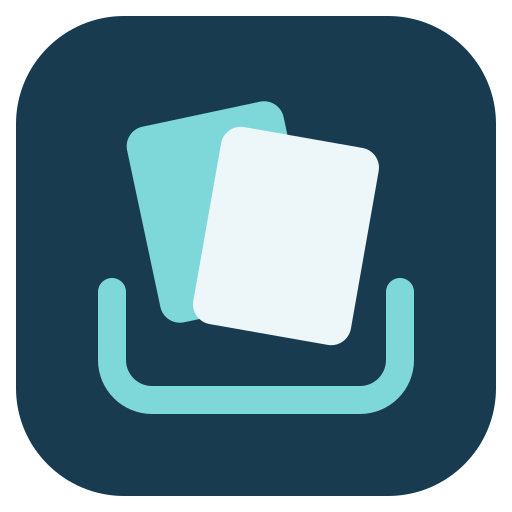

# Shoal



[](https://github.com/coryabarnes/shoal/actions/workflows/ci.yml)

A drag-and-drop shelf for Linux, by [Cory Barnes](https://github.com/coryabarnes).
Drag a file to the edge of your screen, park it on the shelf, go wherever you
need to go, then drag it back out. Copy things and they stack up instead of
overwriting each other. No account, no network calls; everything stays on your
machine.

Written in Rust and GTK4 for KDE Plasma on Wayland. Based on
[Ledge](https://github.com/marcotteink/ledge) for macOS by Matt Marcotte.

## Install

Shoal runs on KDE Plasma **Wayland**, or another Wayland desktop with
layer-shell support. GNOME and X11 sessions are not supported.

### Snap preview

The Snap is built and tested by [GitHub Actions](https://github.com/coryabarnes/shoal/actions/workflows/snap.yml).
Version 0.1.0 has been uploaded to the Snap Store and is awaiting Canonical's
one-time review of its desktop D-Bus name. The tested Snap and checksum are
available from [GitHub Releases](https://github.com/coryabarnes/shoal/releases).

After Store approval, install the preview from the edge channel:

```sh
sudo snap install shoal --edge
```

For files on USB drives or other mounted media, also run:

```sh
sudo snap connect shoal:removable-media
```

The Snap can access ordinary files in your home folder. Hidden folders and
system files remain restricted. Snap data is separate from a native installation:
`~/snap/shoal/current/.local/share/shoal/` and
`~/snap/shoal/current/.config/shoal/`. **Start at Login** is optional and uses
snapd's supported autostart integration. The shortcut requires a desktop with
the GlobalShortcuts portal, such as KDE Plasma. Removing originals uses the
desktop's Trash portal, so files can be recovered through your normal file
manager. If the portal cannot trash an item, Shoal keeps the original.

### Build from source on Fedora

```sh
sudo dnf install cargo gcc gtk4-devel gtk4-layer-shell-devel wl-clipboard
cargo build --release
install -Dm755 target/release/shoal ~/.local/bin/shoal
install -Dm644 assets/shoal.svg ~/.local/share/icons/hicolor/scalable/apps/shoal.svg
shoal &
```

On first launch KDE asks to confirm Shoal's global shortcut (F5). Change it any
time from the menu: **Change Global Shortcut…**.

## Using it

| Do this | And |
| --- | --- |
| Drag a file to the shelf's screen edge | The shelf appears on that screen |
| Drop on the shelf | The item is parked |
| Drag items off the shelf | They're copied to the destination and leave the shelf |
| Drag the stack icon in the header | Everything leaves in one drag |
| Click, Ctrl+click, Shift+click | Select one, several, or a range; drag the selection out together |
| Double-click | Open |
| Right-click an item | Open, Open With…, Show in File Manager, Copy, Copy Path, Pin, quick actions |
| Hover, click the × | Remove the item |
| F5 | Show or hide the shelf, ready for the keyboard |

### Keyboard

| Key | Action |
| --- | --- |
| ↑ ↓ Page Up/Down Home End | Move; with Shift, extend the selection |
| Enter | Open |
| Delete / Backspace | Remove from Shoal |
| Just start typing / Ctrl+F | Filter by name or snippet text |
| Ctrl+A | Select all |
| Ctrl+C | Copy (a snippet copies its text) |
| Ctrl+V | Add clipboard contents |
| Ctrl+P | Pin or unpin |
| Ctrl+Z | Bring back the last removed items |
| Menu / Shift+F10 | Item menu |
| Esc | End filtering, clear selection, then hide |

### Pinned items

Pin things you drop into other places again and again: a signature, a logo, a
template. Pinned items stay on the shelf after you drag them out, are never sent
to the Trash, survive **Clear**, and sit in their own section at the bottom.

### Quick actions

Right-click one or more items:

- **Compress to ZIP**: files and whole folders, into one archive.
- **Convert Image To**: PNG, JPEG or WebP.
- **Resize Image**: half size, or fit within 1920, 1280 or 800 px. Phone photos
  stay upright (EXIF orientation is applied).

Results land on the shelf as new items; originals are never changed.

### Smart previews

- Copied colors (`#ff8800`, `rgb(…)`, `hsl(…)`) show a swatch.
- Copied links show their site and open in your browser; drag one into a browser
  or text field to use the link itself.
- Text snippets show word and line counts, with a preview on hover. Drag one into
  a text field to drop the text, or into a folder to drop the file.
- Images show their pixel size.

Previews are computed locally. Shoal never fetches anything from the internet.

### Clipboard

**Add Clipboard Contents to Shoal** (or Ctrl+V on the shelf) parks whatever is
on the clipboard. With **Automatically Add Clipboard** on, every copy lands on
the shelf silently. Copying something that's already there moves it to the top
instead of duplicating it, and anything a password manager marks as secret is
ignored.

### Menu

From the tray icon, the shelf's menu button, or right-clicking the shelf:
Bring Back Last Removed Files (last 10 removals), Window Position, Window Size,
Remove Original After Drag-Out (sends originals to the Trash), Show Shelf When
Dragging to Screen Edge, Show Shelf for Text Drags, Start at Login, Change
Global Shortcut, Clear.

Items live in `~/.local/share/shoal/`; settings in `~/.config/shoal/settings.json`.

## Development

```sh
scripts/check.sh
```

runs everything CI runs (formatting, clippy with warnings as errors, unit tests,
release build) and then, in a Wayland session, `shoal --self-test`: a debug-only
mode that drives the real shelf through selection, keyboard, pinning, undo,
quick actions, clipboard capture and search, using throwaway data folders.

To check desktop Trash integration in a real desktop session:

```sh
cargo test --locked portal_uses_desktop_trash -- --ignored
```

This check uses uniquely named throwaway files, verifies that a symlink cannot
trash its target, and removes its own Trash fixtures afterward.

## How it differs from Ledge for macOS

Added in Shoal: multi-select, keyboard control, filtering, pinned items, quick
actions, smart previews, multi-monitor edge strips, duplicate-free clipboard
capture.

Different because of Wayland:

- **Auto-show on drag.** Wayland doesn't expose other apps' drags. A 1px
  invisible drop strip on each screen's edge opens the shelf when a drag reaches
  it. Turn it off with "Show Shelf When Dragging to Screen Edge".
- **Moving the shelf by its header** and **At Mouse Pointer** positioning aren't
  possible for Wayland layer surfaces; pick an edge from the menu.
- **Continuity Camera** (Import from iPhone) is Apple-only.
